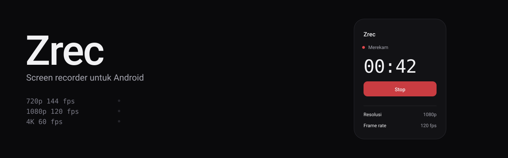

Screen recorder Android tanpa iklan, tanpa watermark, dan tanpa akun. Dibuat native dengan Kotlin dan framework Android saja, jadi APK-nya di bawah 100 KB.

Unduh APK terbaru di halaman [Releases](../../releases/latest). Satu file, tidak ada tambahan lain.

## Fitur

| Fitur | Keterangan |
|---|---|
| Rekaman layar | MediaProjection langsung ke hardware encoder, tanpa re-encode |
| Tombol melayang | Bola yang bisa digeser di luar aplikasi: rekam, stop, jeda, screenshot |
| Sembunyi saat merekam | Bola hilang otomatis supaya hasil rekaman bersih |
| Stop dengan guncangan | Goyang dua kali saat merekam |
| Screenshot | Bisa saat merekam atau tanpa merekam, tersimpan ke `Pictures/Zrec` |
| Audio | Off, mikrofon, suara internal, atau gabungan keduanya |
| Rotasi | Rekaman dipecah ke file baru saat layar diputar, jadi tidak ada video miring |
| Pilihan yang jujur | Resolusi dan frame rate difilter dari kemampuan encoder HP, bukan daftar karangan |

Hasil rekaman masuk ke `Movies/Zrec`, screenshot ke `Pictures/Zrec`.

## Batas kualitas

Frame rate dibatasi per resolusi supaya file tidak meledak dan encoder tidak tersendat. Batas HP tetap berlaku: kalau encoder hanya sanggup 1080p60, aplikasi hanya menawarkan sampai situ.

| Resolusi | Frame rate maksimal |
|---|---|
| 720p | 144 fps |
| 1080p | 120 fps |
| 1440p | 90 fps |
| 4K | 60 fps |

Resolusi terendah 720p. Di bawah itu teks di layar berhenti terbaca setelah dikompres.

## Izin yang diminta

- **Rekam layar** — dialog bawaan Android, muncul setiap kali mulai merekam.
- **Mikrofon** — hanya kalau audio disetel ke Mic atau Mic + internal.
- **Tampil di atas aplikasi lain** — hanya kalau tombol melayang dinyalakan.
- **Notifikasi** — untuk kontrol rekam saat bola sedang disembunyikan.

Tidak ada akses jaringan. Aplikasi ini tidak mengirim apa pun ke mana pun.

## Build sendiri

Butuh JDK 17 dan Android SDK. Tidak perlu Android Studio.

```bash
git clone https://github.com/pancasilayangpertama-maker/zrec.git
cd zrec
gradle assembleRelease
```

APK keluar di `app/build/outputs/apk/release/app-release.apk`.

Repo ini juga punya GitHub Actions: setiap push ke `main` menghasilkan APK sebagai artifact, dan setiap tag `v*` menerbitkan release berisi APK saja.

## Struktur

```
app/src/main/java/com/zrec/recorder/
  MainActivity.kt      layar utama dan pengaturan
  RecorderService.kt   foreground service, notifikasi, guncangan, rotasi
  ScreenRecorder.kt    MediaCodec + MediaMuxer, audio, jeda
  OverlayService.kt    bola melayang
  Shot.kt              screenshot sekali jalan
  Caps.kt              pembacaan kemampuan encoder
  Config.kt            preferensi
```

## Batasan yang diketahui

- Bola melayang tidak bisa terlihat di layar tapi hilang dari rekaman. Android tidak menyediakan itu. Karena itu bola disembunyikan selama merekam, dan kontrol pindah ke notifikasi.
- Audio internal bisa kosong di aplikasi yang melarang perekaman suaranya. Ini keputusan aplikasi tersebut, bukan bug Zrec.
- Kalau "Sembunyikan saat merekam" dimatikan, bola ikut terekam.
- Rotasi di tengah rekaman menghasilkan dua file, bukan satu file yang berputar.

## Lisensi

[MIT](LICENSE). Pakai, ubah, dan bagikan bebas.
